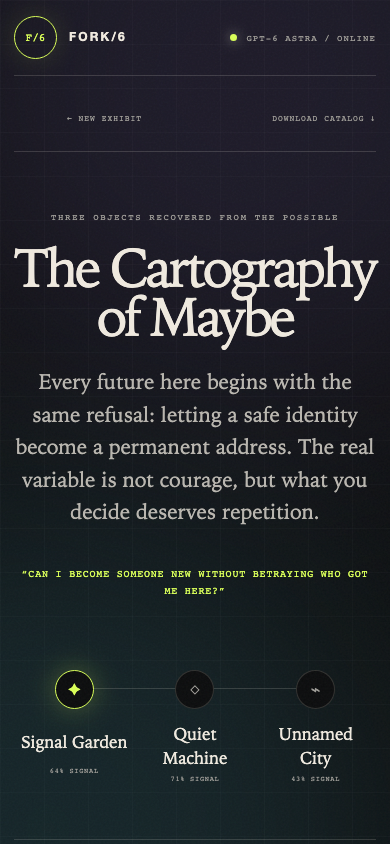

# FORK/6

An interactive **museum of unlived futures**. Give it a decision, an ambition or an impossible idea, and it builds three causally coherent timelines, each with a future artifact, a message from a future self and a small reversible experiment you can try in the present. The futures are written by a model on Amazon Bedrock.


## How it works

1. You write a seed (8 to 1,200 characters), pick a **tone** (luminous, ruthless or strange) and a **horizon** (1, 3, 5, 10 or 20 years).
2. The server builds a curator prompt and calls the Bedrock Converse API. The model must answer with strict JSON.
3. The reply is validated and normalised, then shown as an exhibit: a timeline map, one tab per future, and the artifacts for each.

The app has no runtime dependencies (plain Node 20 or later). The Bedrock token stays on the server and is never sent to the browser.

| Exhibit | Mobile |
|---|---|
|  |  |

## Run it

```bash
cp .env.example .env.local     # then put your temporary Bedrock API key in it
npm start                      # http://localhost:3000
```

`.env.local` is git-ignored. Never commit a real key.

| Variable | Purpose | Default |
|---|---|---|
| `AWS_BEARER_TOKEN_BEDROCK` | Bedrock API key (required) | none |
| `BEDROCK_MODEL_ID` | model or inference-profile ARN | the profile set in `lib/bedrock.mjs` |
| `AWS_REGION` | Bedrock region | `us-east-1` |
| `PORT` | server port | `3000` |

`GET /api/health` reports whether a key is configured. `POST /api/foresee` takes `{ seed, tone, horizon }`.

## Layout

```
server.mjs        HTTP server, static files, /api/health and /api/foresee
lib/bedrock.mjs   Bedrock Converse REST client
lib/futures.mjs   request validation, prompt builder, response parser
public/           the single-page front end (index.html, app.js, styles.css)
test/             node:test unit tests
screenshots/      images used in this README
```

## Checks

```bash
npm run check    # syntax-check every file
npm test         # 9 unit tests, no network needed
```
